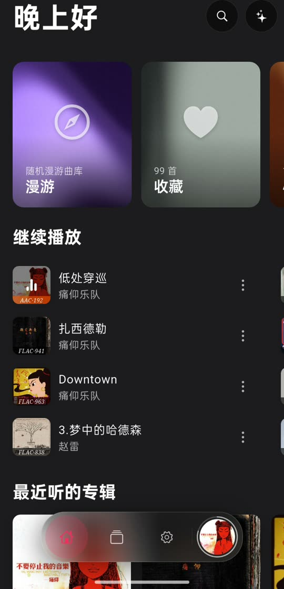
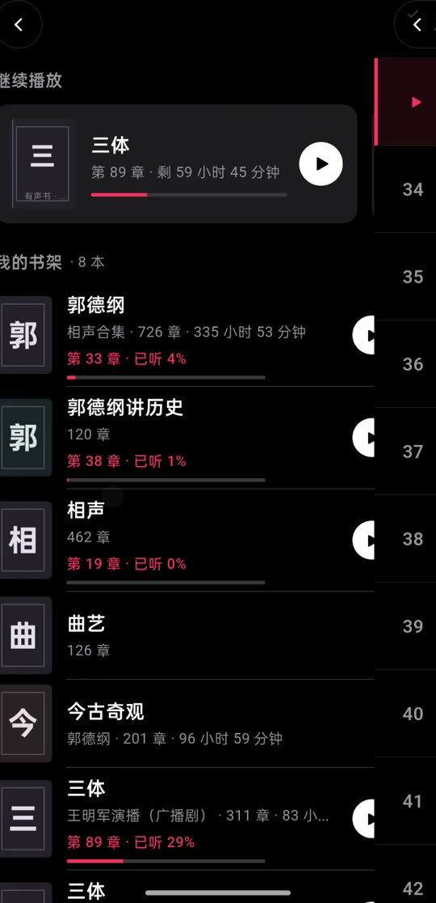
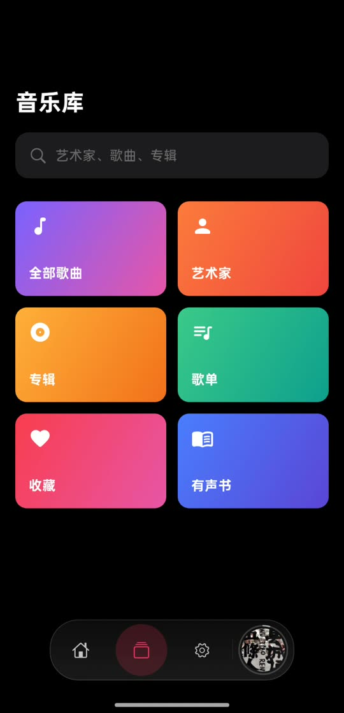
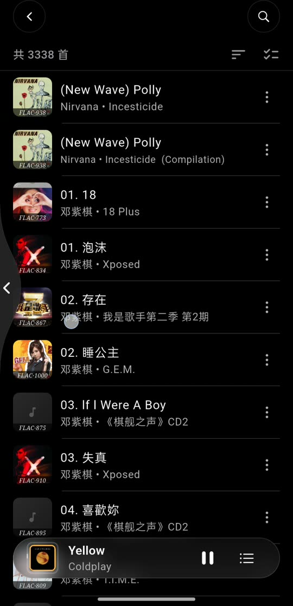
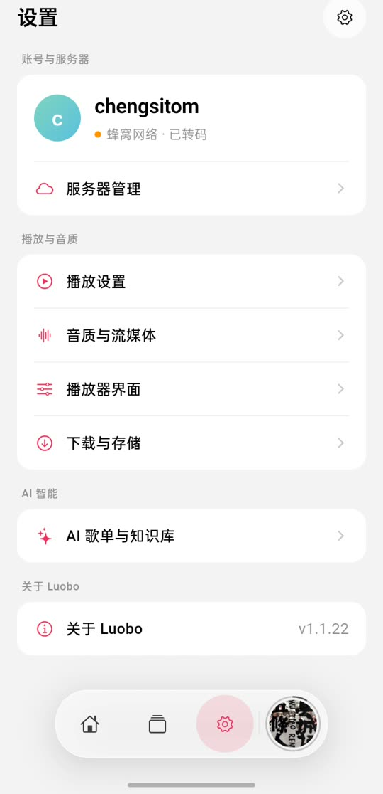

  

<h1 align="center">Luobo（萝卜）</h1>

把自家 NAS 上的音乐和有声书，装进一个好看、好用的播放器里。

> **当前版本：v1.1.22**

Luobo 是一款面向个人音乐库的播放器，支持 **飞牛音乐（fnOS）** 和 **道理鱼** 两个平台。免费、无广告、没有会员套路——只要你有自己的音乐服务器，就能随时随地听自己的歌。

---

## ⬇️ 下载安装

前往 [Releases](https://github.com/chengsitom/Luobo/releases/latest) 下载最新版本。

**Android（推荐）**

- `app-arm64-v8a-release.apk` — 绝大多数手机，优先选这个
- `app-armeabi-v7a-release.apk` — 老款 32 位手机
- `app-x86_64-release.apk` — 模拟器 / ChromeOS
- `app-release.apk` — 通用包，不确定机型时用（体积最大）

支持 Android 6.0 及以上。下载后直接安装即可；如果系统提示「未知来源」，在设置里允许本次安装。

**iOS**

- `luobo-ios.ipa` — 未签名安装包，需要借助 AltStore、Sideloadly 等工具侧载，支持 iOS 15.0 及以上

**电脑**

- Windows：`musly-setup.exe`
- macOS：`luobo-macos.dmg`（未公证，首次打开需在「系统设置 → 隐私与安全性」中允许）
- Linux：`luobo-linux-x64.tar.gz`

> 电脑版由同一套代码构建，功能和手机版基本一致，主要用于大屏听歌。

---

## 📸 界面一览

> 全部来自真机录屏截帧（v1.1.22），没有补图、没有设计稿。

| | | |
|:---:|:---:|:---:|
|  |  |  |
| **首页** 漫游、继续播放、最近听的专辑 | **播放页** 大封面、转码与音质信息 | **全屏歌词** 逐行高亮 |
|  |  |  |
| **车载模式** 大字歌词，蓝牙车机可逐句显示 | **心动歌单** 按风格与场景组合的歌单 | **有声书** 继续收听 + 我的书架 |
|  |  |  |
| **音乐库** 歌曲 / 专辑 / 歌手 / 歌单 / 收藏 / 有声书 | **全部歌曲** 排序记忆、多选操作 | **设置** 服务器、播放、音质、主题 |

## 🎵 它能做什么

### 听自己的音乐

- 连接你的飞牛音乐或道理鱼服务器，在线播放整个曲库
- 支持 FLAC、ALAC、WAV、MP3、AAC 等常见格式
- 智能转码：外网自动降低码率省流量，局域网自动切回原始音质
- 无缝播放、淡入淡出、10 段均衡器、音量均衡、倍速与音高调节
- 离线下载，没网也能听；也可以扫描手机里的本地音乐
- 播放队列、随机 / 循环、手势切歌，操作跟主流音乐 App 一致

### 歌词

- 优先显示服务器自带的歌词
- 服务器没有歌词时，自动从网络歌词库匹配
- 支持逐行滚动、全屏歌词、锁屏歌词、通知栏歌词、车机歌词

### 听有声书（道理鱼）

- 独立书架 + 「继续收听」，多本书来回切换不迷路
- 章节页支持「全部 / 未听 / 已听」筛选、一键重播本章
- 章节很多时右侧有快速滑动条，每 50 集一个刻度，长书也能秒定位
- 书内搜索只搜这本书的章节，输入数字可以直接跳到第 N 集
- 自动记住每本书听到第几章、第几分钟，下次接着听
- 已听章节自动标记，也可以手动标记已听 / 未听
- 听书时底部保留之前那首歌的封面，点一下就能切回音乐

### 发现新歌

- **每日推荐** — 每天一批适合你的歌，当天固定
- **为你制作** — 通勤、专注、睡前、最爱等多种场景 Mix
- **探索发现** — 只推你还没听过的歌
- **漫游** — 一键进入全曲库随机播放，听不完
- **心动歌单（道理鱼）** — 每天 12 组按风格和场景搭配的歌单，可以换一批、播放全部、随机播放，也能一键保存成自己的歌单
- **网络电台** — 收听服务器提供的电台流

### 开车时听

- **车载模式** — 大字歌词、环形进度、屏幕常亮，驾驶中一眼看清
- 支持 Android Auto / CarLife，在车机上直接浏览和播放

### 了解自己的听歌习惯

- 总听歌时长、播放次数、歌手与歌曲数量
- 完播率、时段偏好、流派分布、能量曲线
- 最常听、最常跳过、单曲循环、新发现、老朋友
- 连续听歌天数、月度趋势、流派演变

### 用 AI 生成歌单

- 支持 DeepSeek、OpenAI、Kimi、通义等多家 AI 服务，用自己的 API Key
- 三种模式：按最近听歌生成、按场景生成、直接描述想要的感觉
- 生成结果可预览、可保存；也可以让 AI 先「读」一遍曲库，后续推荐更准
- 知识库支持导出 / 导入，换设备不用重复生成

### 外观与细节

- 对标飞牛音乐的视觉风格：悬浮毛玻璃、大圆角、流体渐变背景
- 深色 / 浅色主题自动跟随系统
- 设置页分组清晰，二级页标题会随上滑自然出现
- 支持 27 种界面语言，流派名自动中文化
- 多服务器管理，切换账号不影响当前播放
- 内置更新检查，新版本发布后会提醒你

---

## 🚀 快速开始

Luobo 本身不提供音乐内容，需要配合你自己的服务器使用。

1. **准备好服务器**：在飞牛 NAS 上安装并开启「飞牛音乐」，或部署好道理鱼
2. **打开 Luobo**：首次启动会进入登录页
3. **填写连接信息**：
   - 服务器地址（例如 `https://music.example.com`，局域网可填 `http://192.168.1.10:4533`）
   - 用户名和密码
   - 旧版服务器可打开「旧版认证」；使用自签证书时可导入证书
4. **连接**：成功后会自动同步曲库，首页就能开始听了

> 同时保存了局域网和外网地址时，Luobo 会自动挑选当前网络下可用的那个；连接失败也会自动换另一个再试一次。

---

## ❓ 常见问题

**连不上服务器怎么办？**

先确认手机和服务器在同一网络，或服务器已做内网穿透 / 端口映射；再检查地址是否带 `http://` 或 `https://`、端口是否正确。局域网地址用 `http`，外网建议用 `https`。如果服务器使用自签证书，可以在登录页的高级选项里导入证书。

**为什么有些歌听起来「音质变差了」？**

外网播放时默认会智能转码以节省流量。想听原始音质，可以在「设置 → 音质与流媒体」里调整码率或关闭转码；连接局域网时会自动使用原始音质。

**为什么没有歌词？**

Luobo 会先找服务器里的歌词，再去网络歌词库匹配。纯音乐、冷门歌曲可能确实没有歌词；也可以在服务器上为歌曲补上 `.lrc` 文件。

**怎么更新？**

设置页可以直接检查更新；也可以随时到 [Releases](https://github.com/chengsitom/Luobo/releases/latest) 下载新版本覆盖安装，歌单、收藏和设置都会保留。

**我的账号和数据安全吗？**

服务器地址和账号密码只保存在你的设备上，不会上传到任何第三方。匿名使用统计默认关闭，可以在「设置 → 关于」里随时开关。诊断日志只有在你主动导出时才会生成。

**为什么心动歌单和有声书找不到？**

这两个功能目前只对道理鱼服务器开放；连接飞牛音乐时不显示。

---

## 💬 反馈与建议

遇到问题或有功能建议，欢迎到 [Issues](https://github.com/chengsitom/Luobo/issues) 反馈。提问时附上手机型号、系统版本和 App 版本号，能更快定位问题。

---

## 🛠️ 版本历史

**v1.1.22（当前）** — 有声书稳定性、播放自救、车机歌词：

**🎧 有声书（道理鱼）**
- ✅ **修复「转码播放时没播完就跳到下一集」** — 章节改为原码直出，播放器能拿到真实时长，拖动也变回原生 seek
- ✅ **网络抖动不再被当成「本章听完」** — 断流会停在原地续播，接不上才跳过；正常播完不受影响
- ✅ **跨端续播** — 进度同步到服务器：手机上听到哪，网页端或另一台设备接着听；本地缓存兜底，离线与弱网照常秒开

**🔊 播放**
- ✅ **播放失败自动救三次** — 换登录票据 → 降低码率 → 退回原码；仍然失败会明确提示「播放失败」，不再点了没反应
- ✅ 修复「播放页 → 更多 → 歌手/专辑」后底部播放条消失
- ✅ 修复列表最后一行被播放条压住（歌手 / 专辑 / 收藏 / 历史 / 流派 / 歌单 / 音乐库 / 发现）

**📋 列表**
- ✅ 排序偏好会记住（全部歌曲 / 收藏 / 歌单 / 歌手），退出再进不再重置

**🚗 车机与通知栏**
- ✅ **新增「蓝牙 / 车机歌词」** — 连接蓝牙音频时把当前歌词行写进媒体标题，艺人 / 专辑显示「歌名 - 艺人」，车机屏幕即可逐句显示歌词（设置 → 播放 → 歌词 可关闭；开启后手机通知栏标题也会变成歌词）

**🌐 连接**
- ✅ 服务器地址只有 IPv6、而当前网络没有 IPv6 时，会明确提示原因，不再只显示「连接超时」

**🧪 质量**
- ✅ 静态检查 0 报错、单元测试 366 项全绿（5 项跳过）

**v1.1.21** — 有声书全新改版、心动歌单、页面标题随滚动出现：

**🎧 有声书（道理鱼）**
- ✅ **书库重新设计** — 顶部「继续收听」+ 行式书架，没有封面也有专属的文字书封
- ✅ **章节页重做** — 大号书封、全书进度、筛选（全部 / 未听 / 已听）、一键重播本章
- ✅ **快速定位** — 章节多时右侧有快滑条，每 50 集一个刻度
- ✅ **书内搜索** — 只搜本书章节，输入数字可直接跳到第 N 集
- ✅ **进度记得更细** — 记住章节和分钟数，已听章节自动标记，也能手动标记已听 / 未听
- ✅ **听书时底栏保留音乐封面** — 点一下就能切回之前那首歌

**💛 心动歌单（道理鱼）**
- ✅ 首页新增入口，每天 12 组按风格与场景搭配的歌单，支持换一批
- ✅ 详情页可播放全部、随机播放，也能一键保存为自己的歌单

**🎨 界面**
- ✅ 设置等二级页初始只显示返回按钮，上滑后才出现「返回 + 标题」，页面更干净
- ✅ 首页歌单卡长标题智能断行，不再把名字拆得七零八落
- ✅ 首页「最近播放」专辑区改名，避免与歌曲区重名
- ✅ 专辑排序菜单标出当前排序字段与升降序

**🔊 播放**
- ✅ 修复道理鱼转码播放中途突然跳回起播点的问题
- ✅ 本地与离线文件播放更稳定

**🧪 质量**
- ✅ 静态检查 0 报错、单元测试 310 项全绿（5 项跳过）

**v1.1.20** — 底部导航与播放条重做、首页大卡：

**🧭 底部导航（一级页）**
- ✅ **悬浮胶囊** — 底栏收窄为居中的胶囊，两侧留白，不再横贯整屏，底部内容可以延伸到它下面
- ✅ **封面槽升级** — 右侧当前专辑封面放大，外圈加了一圈常驻的播放进度环，暂停时保持原位不动
- ✅ **封面可直接点开播放页** — 一级页不用再通过其它入口进入正在播放

**🎵 迷你播放条（二级页）**
- ✅ **胶囊形态** — 播放条变矮变圆，与底栏观感统一，左右留白更从容
- ✅ **进度改到封面环上** — 原来贴底的细进度线去掉，避免胶囊端头被切
- ✅ **转码状态一眼可见** — 封面描边颜色区分「正在转码 / 已转码 / 未转码」，长按封面的信息卡也改成了贴封面弹出的毛玻璃卡片，不再从屏幕中央弹深色条
- ✅ **一级页与二级页分工明确** — 一级页只显示底栏，进入二级页后只显示播放条，两者不再叠在一起

**🏠 首页大卡**
- ✅ **「漫游 / 收藏」与「你的歌单」改为流体大卡** — 按封面取色生成流动渐变，标题字号放大后更醒目
- ✅ **歌单封面改用名字首字** — 歌单里有很多首歌，单张封面代表不了，改用首字字母牌，每张都不重样

**📐 其它**
- ✅ **设置页、关于页、听歌报告等二级页** — 底部留白适配新的悬浮条，最后一条内容不会被玻璃压住
- ✅ 静态检查 0 报错、单元测试 268 项全绿（5 项跳过）

**v1.1.19** — 全新界面设计语言、首页漫游、歌词与音频打断修复：

**🎨 全新界面设计语言（对标飞牛音乐）**
- ✅ **统一视觉** — 悬浮毛玻璃、大圆角、玫红强调色贯穿全 App，观感更一致、更现代
- ✅ **设置页重做** — 重新组织为「分组列表 + 二级页」，查找设置更顺手

**🗑️ 移除旧的自定义主题系统**
- ✅ **下线 Now Playing 自定义主题** — 移除主题编辑器与自定义组件，换来更轻、更稳、启动更快的播放界面
- ⚠️ **升级影响** — 原先创建的自定义 Now Playing 主题将不再可用

**🏠 首页「漫游」与快捷入口**
- ✅ **新增漫游** — 首页一键进入全曲库随机播放 + 无限续播，听不完
- ✅ **入口更清晰** — 首页改为「歌单 / 收藏 / 漫游」，「最近播放」不再混入歌单与收藏
- ✅ **封面修复** — 修复「你的歌单」封面被裁、显示不全的问题

**📑 列表排序更直观**
- ✅ **全部歌曲排序** — 改为「选字段 + 选升降」两步，比原来一长串选项更清楚
- ✅ **全新排序浮层** — 贴着按钮淡入浮出的毛玻璃菜单，手感对齐飞牛音乐

**🎤 歌词显示修复**
- ✅ **优先用服务器歌词** — 修复「服务器明明有歌词，却显示成网易云 / LRCLIB 对不上的歌词」
- ✅ **车机 / 通知栏 / 锁屏补齐歌词** — 服务器没有歌词时也能显示（原来只会显示歌手名），同一首歌第二次播放也不再丢歌词
- ✅ **纯文本歌词** — 没有时间轴的歌词在车机 / 通知栏静态显示首行，不再回落成歌手名

**🔊 音频打断修复（Android）**
- ✅ **被打断后不再「在播却没声音」** — 接打电话、导航播报、其他 App 抢占后，Luobo 会正确暂停；打断结束自动恢复播放与音量，无需再手动暂停再播放

**🧪 质量**
- ✅ 静态检查 0 报错、单元测试 261 项全绿（5 项跳过）

**v1.1.18** — 首页流动背景与推荐优化、车机歌词修复：

**🏠 首页流动背景**
- ✅ **封面取色流动渐变** — 首页卡片与二级页按封面主色生成流动渐变背景，更有氛围感
- ✅ **推荐更少重复** — 每日推荐与探索发现加入探索配额与跨天冷却，收藏变更即时生效

**🎤 车机 / 通知栏歌词修复**
- ✅ **歌词逐行推送** — 歌词随播放实时推送到通知栏与车机媒体卡片
- ✅ **车机命令更稳** — 修复车机侧早期媒体命令偶发丢失的问题

**v1.1.17** — 品牌独立与有声书体验改版：

**🏷️ 品牌独立**
- ✅ 全 App 品牌统一为 Luobo（登录、服务器连接、桌面侧栏、通知、Windows 媒体面板等）
- ✅ 自动更新、隐私政策等链接改指 Luobo 自有仓库
- ✅ 移除原作者捐赠与社区入口

**🎧 有声书体验改版**
- ✅ 列表页改网格布局，新增「继续收听」横滑入口
- ✅ 详情页连续章节列表 + 右侧快滑索引（章节多时）+ 章节直跳 / 书内搜索；大字号下不再溢出
- ✅ 进度记忆更稳：暂停 / 拖动进度 / 退到后台都会即时保存
- ✅ 重新进入详情页更快

**v1.1.16** — 播放核心稳定性修复：
- ✅ 修复部分场景下「点了播放却迟迟没反应 / 没声音」，播放更跟手
- ✅ 无声时自动恢复更及时
- ✅ 有声书续播修复「点续播却从头开始」
- ✅ 队列整轮播完后再点播放可从头继续，不再停在最后一首
- ✅ 转码播放的进度条总时长显示更准

**v1.1.15** — 道理鱼有声书接入与歌词页快速关闭：

**🎧 有声书（道理鱼）**
- ✅ 接入道理鱼有声书列表与章节播放
- ✅ 纯客户端进度记忆：记住「第几章 + 播放到哪」，下次定位恢复，听完标记「已听完」
- ✅ 列表页 / 详情页共享「继续收听」入口
- ✅ 播放有声书时不会误触发自动进入车载模式

**🎤 歌词页快速关闭**
- ✅ 歌词列表滚到顶部后快速下拉即可关闭，与歌词滚动互不打架

**v1.1.14** — 登录页与服务器管理改版（Apple Music 风两步引导）：

**🔐 登录页改版**
- ✅ 原来一屏要填一堆东西，拆成「填服务器 → 连接」两步，专业选项（旧版认证 / 自签证书）折叠进高级项
- ✅ 浅色分组卡片、无边框输入的 Apple Music 视觉风

**🗂️ 服务器管理二级页**
- ✅ 已保存的服务器收进独立二级页，可编辑 / 分享二维码 / 切换 / 删除
- ✅ 扫码导入失败时自动改用预填表单兜底

**v1.1.13** — 道理鱼接入、多服务器管理与全量切换：

**🐟 道理鱼接入**
- ✅ 支持连接道理鱼服务器（浏览 / 搜索 / 播放 / 歌单 / 收藏 / 歌词），纯客户端适配、服务端零改动

**🔁 多服务器管理与全量切换**
- ✅ 设置页列出所有已保存服务器，可编辑、分享二维码、确认后一键整体切换
- ✅ 切换后彻底隔离旧服务器数据，不再有请求打到旧服务器

**🗑️ 移除 Jukebox 模式**
- ✅ 移除无人使用的服务器端远程播放，简化界面

**v1.1.12** — 播放无声自愈与自动车载守卫加固：

**🔇 播放无声修复**
- ✅ 蓝牙断开 / 长时间后台后，再次播放不再「没声音」，会自动重建并回到原位置
- ✅ 退后台回到前台后播放更可靠，但不会擅自替你恢复播放

**🚗 自动进入车载更稳**
- ✅ 看歌词时不会误自动进入车载模式，退出歌词后再计时

**v1.1.11** — 歌词视觉对齐 Apple Music 与播放页自动进车载：

**🎤 歌词页视觉**
- ✅ 去掉模糊与阴影，远近行用透明度区分，更干净、低端机更流畅
- ✅ 字号加大、字重与行高微调，更易读

**🚗 播放页自动进入车载**
- ✅ 全屏播放页停留 30 秒无操作自动进入车载模式（电台除外），任意触摸即重置计时，暂停则停止

**v1.1.10** — 局域网连接强制原始音质：
- ✅ 连接局域网时自动关闭转码，直出无损原码流（WiFi / 移动码率设置此时不生效）
- ✅ 局域网与外网之间切换即时生效
- ✅ 局域网连接时流媒体设置页顶部显示「局域网连接中 · 强制原始音质」提示

**v1.1.9** — 封面缓存全面优化：
- ✅ 连续加载封面更省流量、更快（复用连接）
- ✅ 同一首歌再次播放不再重复下载高清封面
- ✅ 冷启动首屏封面滚动更顺，不再一张张「现解码」
- ✅ 换密码不再导致封面缓存全失效；多服务器 / 多账号封面不串图
- ✅ 登出不清封面缓存，同账号登回秒开
- ✅ 封面缓存超过约 512MB 自动清理最旧的

**v1.1.8** — 音乐库四 Tab 横滑与登录连接兜底：

**🎵 音乐库四 Tab 横滑**
- ✅ 艺术家 / 专辑 / 歌曲 / 收藏改为可左右跟手滑动切换（本地模式自动扩展 6 Tab），有惯性落页
- ✅ 每个 Tab 滚动位置独立保留，切走再回来不丢位置

**🔌 登录 / 连接更稳**
- ✅ 首次连接失败时自动改用备选地址（局域网 ↔ 外网）重试一次，减少偶发登录失败
- ✅ 切换网络时立即重新评估可用地址

**🏠 首页探索发现**
- ✅ 单曲横卡补「歌手 · 专辑」副标题，认歌更快

**v1.1.7** — 首页 / 设置页 / 艺术家页三大重构与刷新反馈：

**🏠 首页重构（Apple Music 风格）**
- ✅ 个性化混合推荐（每日推荐、继续播放、多种 Mix、探索发现、最近播放），封面按主色生成渐变
- ✅ 继续播放改双行横滑网格；探索发现每天固定一批新歌
- ✅ 歌曲列表二级页：封面取色大图标题 + 随机 / 播放 / 加入队列
- ✅ 全 App iOS 侧滑返回；首页顶部直达设置

**🎛️ 设置页重构**
- ✅ 从 8 个横滑 Tab 改为「单列表分组 + 二级页」，查找更顺手
- ✅ 音质与流媒体独立二级页
- ✅ 新增「机制说明」入口，用大白话解释各功能的推荐与计算逻辑
- ✅ 新增「更新日志」页（即本页内容）

**🎵 音乐库艺术家页改版**
- ✅ 方形封面网格 + 字母索引，常听歌手置顶
- ✅ 没有歌手图时自动用专辑封面拼贴 / 渐变首字母兜底，页面不空

**🔁 刷新反馈**
- ✅ 刷新按钮带 loading 态，完成后提示成功 / 本地重载 / 失败原因

**v1.1.6** — 听歌统计修复与封面请求统一：
- ✅ 修复切歌时把新歌误记为「已完成」的统计竞态
- ✅ 听歌报告周末 / 工作日、时段偏好统计口径修正，只统计有效播放
- ✅ 单曲循环每轮独立计次
- ✅ 全 App 封面请求尺寸统一，减少重复下载

**v1.1.5** — 音质信息、艺术家索引、缓存与性能优化：
- ✅ 歌曲封面带音质角标（如 FLAC·964），点 ⋯ 可看格式 / 码率 / 采样率 / 位深 / 大小
- ✅ 艺术家按拼音首字母分组 + 右侧字母快速跳转
- ✅ 顶部搜索支持歌单 / 艺术家 / 专辑 / 歌曲四类
- ✅ 迷你播放器封面描边区分局域网（绿）/ 外网（橙），长按看连接详情
- ✅ 设置 → 存储显示封面缓存占用，清空带二次确认
- ✅ 同专辑共享封面缓存、按显示尺寸取图，播放更省资源、不闪占位图
- ✅ 服务器配置可直接编辑，添加新服务器不断开当前连接
- ✅ 车载模式补「歌手 · 专辑」副标题

**v1.1.4** — UI 打磨 + AI 歌单升级 + 网络与缓存优化：
- ✅ 全 App 可点卡片 / 列表项加按压缩放反馈，手感更灵动
- ✅ 首页下拉刷新，iOS / Android 一致
- ✅ 首页说明入口（ⓘ），解释各分区的来源逻辑
- ✅ 迷你播放器显示局域网 / 外网状态
- ✅ 登录支持只填局域网地址
- ✅ LRCLIB 查不到歌词时自动回退网易云，提升中文歌词命中
- ✅ AI 歌单独立设置入口，支持「最近听歌 / 场景模式 / 自由文本」三种生成，可选数量
- ✅ AI 知识库生成进度全局保留，离页不丢、可增量续传
- ✅ 封面与流式缓存优化，自动清理旧临时文件
- ✅ 随机播放重构，保证一轮内每首只播一次，修复重复播同一首
- ✅ 底部弹窗改纯色背景，中文排版行高优化

**v1.1.3** — Luobo 独立版本，基于 Musly v1.0.13：
- ✅ 正式更名为 Luobo（萝卜）
- ✅ 首页歌曲列表隐藏时长、歌名完整显示；播放页封面上方显示歌名
- ✅ 转码流完整进度控制（进度条正常 + 可拖动跳转）
- ✅ 音乐库四 Tab 滑动切换（艺术家 / 专辑 / 歌曲 / 收藏）
- ✅ 新增车载模式、听歌报告、AI 歌单（差异化功能详见上文）

**v1.0.13（Musly 上游基线）** 包含：
- ✅ 无缝播放（Gapless Playback）
- ✅ LRCLIB 歌词自动查询
- ✅ 音频淡入淡出、音高控制
- ✅ Dolby Atmos 支持检测
- ✅ 所有平台 Bug 修复与优化

详见 [CHANGELOG.md](CHANGELOG.md)

## 🙏 致谢与许可

Luobo 基于开源项目 [Musly](https://github.com/dddevid/Musly) 二次开发，感谢原作者的工作与分享。

本项目采用 **CC BY-NC-SA 4.0** 许可协议：欢迎自由使用、修改和分享，但不可用于商业分发。详见 [LICENSE](LICENSE)。
